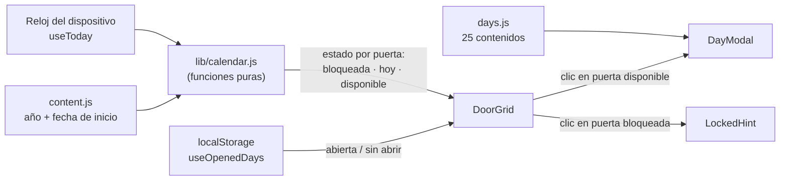

# Plan Bloque 4 — Calendario de adviento

> Solo plan, sin código. Cada fase termina con un criterio de «listo». Fecha de redacción: 24-nov-2026. **La puerta 1 se abre el 1-dic: quedan 7 días**, así que el plan separa un *mínimo publicable* (Fases 0-5 + 7) de lo que puede esperar.

## 1. Punto de partida (lo que ya hay y lo que falta)

| Pieza | Hoy | Para un adviento real |
|---|---|---|
| `blocks/gallery` | Cuadrícula de puertas doradas; **cualquier puerta se abre en cualquier momento** | Falta lo esencial: **bloqueo por fecha** |
| `useOpenedDoors` | Recuerda en `localStorage` qué puertas se abrieron | Se reutiliza la idea (clave por año) |
| `PhotoModal`, `GalleryTile` | Modal pergamino y puerta que gira en 3D | Se **copian y adaptan** (ver §5, decisión de reutilización) |
| `core/registry.js` + `vite.config.js` + `.env` | 3 bloques, un interruptor por bloque | Se añade un 4.º con el mismo patrón (`docs/NUEVO_BLOQUE.md`) |
| Paleta/fuentes (`base.css`) | Azul marino, oro, crema, pergamino, lacre · Great Vibes / Playfair / Nunito | Se mantiene: el adviento debe verse de la misma familia |
| Servidor | Ninguno (sitio estático) | Sin backend: la fecha la decide el dispositivo (ver §7) |

## 2. Decisión de arquitectura: bloque nuevo `advent` (no tocar la galería)

- **Por qué un bloque nuevo.** La galería es «abre lo que quieras»; el adviento es «hoy toca esta». Son reglas distintas y forzarlas en un mismo bloque lo llena de condicionales. Además el Plan Bloque 2 (música) está tocando la galería: así **no hay choques** entre planes.
- **Qué se toca fuera del bloque**: solo 4 líneas de configuración (`registry.js`, `vite.config.js`, `.env.example`, docs). La carta, la galería y el cesto **no deben notar nada**.
- **Qué NO se toca**: `AudioProvider` (se usa tal cual; cuando el Plan 2 lo amplíe a playlist, un bloque con una sola pista seguirá funcionando).

### Estructura de carpetas

```
carta-magica/src/blocks/advent/
├── index.jsx                 # raíz: une fecha + puertas abiertas + modal
├── block.meta.js             # id, título, música (opcional)
├── content.js                # título, año, fecha de inicio, textos de pantallas
├── days.data.js              # los 25 contenidos (texto puro, sin imports de Vite → testeable)
├── days.js                   # le añade las imágenes de assets/days/ (import.meta.glob)
├── advent.css                # estilos propios, clases con prefijo .advent-
├── themes/                   # un estilo por carpeta (§4.8): theme.css, theme.js, assets/
├── lib/
│   ├── calendar.js           # lógica PURA de fechas y estados de puerta
│   └── calendar.test.js      # pruebas con node --test
├── hooks/
│   ├── useToday.js           # «hoy» local; se refresca a medianoche y al volver a la pestaña
│   └── useOpenedDays.js      # puertas abiertas en localStorage (clave por año)
├── components/
│   ├── AdventHeader.jsx      # título, progreso «7 de 25», cuenta atrás
│   ├── DoorGrid.jsx / Door.jsx
│   ├── DayModal.jsx          # elige la vista según el tipo de contenido
│   ├── views/                # Mensaje, Foto, Vale, Cancion, Reto
│   ├── LockedHint.jsx        # aviso «aún no: se abre el 12 de diciembre»
│   └── Finale.jsx            # puerta 25 (Navidad) especial
└── assets/ (days/01.webp … 25.webp, sounds/ opcional)
```

### Flujo de datos



**Por qué la lógica de fechas es una función pura aparte**: es la única parte donde un error arruina el regalo (abrir un día antes, o no poder abrirlo). Al ser pura se prueba con `node --test` sin navegador, igual que el resolvedor de bloques.

Reglas que fijará `calendar.js` (y sus pruebas):
1. Se compara la fecha como texto `AAAA-MM-DD` del **calendario local del dispositivo**, no con milisegundos (evita errores por horario de verano y husos).
2. Puerta N: `bloqueada` si su fecha es posterior a hoy · `hoy` si es hoy · `disponible` si ya pasó. **Una puerta pasada sin abrir sigue abriéndose** (el calendario no castiga).
3. Antes del 1-dic: todo bloqueado + cuenta atrás. Después del 25-dic: todo disponible. Otro año distinto al configurado: se trata igual (pasado = todo abierto).
4. `useToday` se actualiza solo a medianoche y al volver a la pestaña (en el móvil la página puede quedar abierta días).
5. **Modo vista previa** `?preview=2026-12-05` en la URL, para que tú pruebes cualquier día desde el móvil. Entrada inválida se ignora.

## 3. Lenguaje y herramientas (y por qué)

| Qué | Elección | Por qué |
|---|---|---|
| Lógica y componentes | **JavaScript (ES modules) + JSX** | Es lo que usa el proyecto. TypeScript pediría `tsc`, tipos y configuración = **dependencias nuevas**, y te preocupa la seguridad de `npm`. Las ayudas de tipos se cubren con comentarios JSDoc |
| UI | **React 19** | Ya instalado |
| Estilos | **Tailwind 4** para disposición + **CSS propio** (`advent.css`, prefijo `.advent-`) para puertas, brillos y 3D | Mismo reparto que `gallery.css` |
| Animación | **Framer Motion** (modal, aparición) + **CSS** (giro de puerta, pulso de «hoy», nieve) | Lo continuo y barato va en CSS; lo orquestado en Framer |
| Pruebas | **`node --test`** | Sin dependencias |
| Datos | Archivos JS (`days.data.js`) | Sin backend ni base de datos |
| **Dependencias nuevas** | **Ninguna** | Regla del proyecto |

### Librerías evaluadas (24-nov-2026)

Datos tomados de sus webs oficiales; lo que las páginas no decían se marca como «no verificado».

| Librería | Qué es hoy | Veredicto para este bloque |
|---|---|---|
| **Motion** (motion.dev) | Es el nuevo nombre de **Framer Motion**: su web dice «prev Framer Motion». Para React se instala `motion` y se importa de `motion/react`. Ya tienes `framer-motion` 12.38 | **Ya la usas; no hay nada que instalar.** Cambiar el paquete al nombre nuevo es un renombrado cosmético que toca los imports de los tres bloques y cambia una dependencia: se deja para cuando haga falta. No verificado: si `framer-motion` seguirá publicándose |
| **GSAP** (gsap.com) | Su página de precios dice «now 100 % free» (con plugins como ScrollTrigger y SplitText, gracias a Webflow). No verificado: el texto exacto de la licencia y sus restricciones (están en sus Términos, que no se leyeron), y el peso del núcleo | **No.** Sería un segundo motor de animación junto a Motion (dos formas de hacer lo mismo), más peso y una dependencia nueva, para resolver problemas que este bloque no tiene: el giro de puerta y el pulso de «hoy» son CSS, el modal es Motion, la nieve es CSS. Se reconsidera solo si se hace el concepto B (pueblo en SVG) o un final con línea de tiempo larga |
| **React Bits** (reactbits.dev) | Colección de **215+ componentes** animados que se copian como código fuente (no es un paquete). Su README dice «MIT + Commons Clause». Se instalan con `npx shadcn@latest add …` o `npx jsrepo@latest add …`, o copiando a mano. Tiene categoría de fondos con partículas. No verificado: las dependencias de cada componente, el texto completo de la licencia y si existe un componente de nieve/confeti | **Solo como inspiración.** (1) Los instaladores usan `npx`, y tu regla con `npm` lo descarta: si algo gusta, se copia **a mano un solo archivo**. (2) Se revisan sus `import` antes de aceptarlo: solo vale si usa React y Motion, nunca si arrastra `gsap`, `three` u `ogl` por un adorno. (3) Hay que leer la licencia completa. (4) Su estilo «creativo/shader» choca con el tono cálido dorado-y-azul, y los fondos WebGL gastan batería en móviles modestos |

**Criterio:** una librería entra cuando resuelve un problema que ya tienes, no uno que podrías tener. Aquí el calendario necesita fechas bien calculadas y buen diseño, y no más animación. Ojo: `ui-ux-pro-max` trae presets de GSAP y puede sugerirlos en sus resultados; la decisión sigue siendo la de esta tabla.

## 4. Diseño UX/UI

### 4.1 Concepto visual (decisión tuya, §6)

| Opción | Qué es | Coste | Veredicto |
|---|---|---|---|
| **A. Puertas doradas** (recomendada) | Evolución de las puertas de la galería sobre azul noche con estrellas y nieve suave | Bajo | Coherente con el sitio, rápida de terminar y publicar a tiempo |
| B. Casa/pueblo nevado con ventanas | Ilustración SVG con 25 ventanas | Alto (hay que dibujarla) | Bonita, pero no llega al 1-dic |
| C. Sobres con lacre | Cada día es un sobre kraft con sello numerado; al abrir sale la carta | Medio | Conecta con la carta (bloque 1), pero reutilizaría assets de otro bloque. **Buena mejora posterior** («skin» nueva sobre la misma lógica) |

La separación lógica/diseño del §2 permite empezar con A y cambiar a C sin rehacer la lógica.

### 4.2 Pantalla principal (móvil primero: lo abrirá desde WhatsApp)

```
┌───────────────────────────┐
│  ✦  Calendario de adviento ✦ │   Great Vibes, crema
│  Hoy: 5 de diciembre         │   Nunito
│  Te espera la puerta 5  ↓    │   (botón que baja a la puerta de hoy)
│  ●●●●●○○○…  4 de 25 abiertas │   progreso
│ ┌────┬────┬────┬────┐        │
│ │ 1✓ │ 2✓ │ 3✓ │ 4✓ │        │   abiertas: miniatura + marca
│ ├────┼────┼────┼────┤        │
│ │ 5★ │ 6🔒│ 7🔒│ 8🔒│        │   5 = HOY (brillo pulsante)
│ ├────┼────┼────┼────┤        │
│ │ 9🔒│ …  (hasta la 24)       │   bloqueadas: oro apagado
│ ├────┴────┴────┴────┤        │
│ │   25 · Navidad 🎁   │        │   puerta final: ancho completo, más grande
│ └───────────────────┘        │
└───────────────────────────┘
```
Móvil: **4 columnas × 6 filas (1-24) + la puerta 25 en una fila propia a todo el ancho** (puertas ≥ 72 px, cumple el mínimo táctil). Escritorio: 6 × 4 + fila final, centrado, ancho máx. ~900 px. Por qué así y no 5×5: la 25 no es «una más», es el cierre; darle su fila la hace ver como el premio final y deja el resto en una cuadrícula regular.

**Críticas de usuario que condicionan el diseño:**
- **Orden numérico, sin barajar.** Los calendarios físicos esconden los números en desorden; en pantalla eso solo hace perder tiempo. La gracia se consigue con el brillo de «hoy» y el scroll automático a la puerta del día.
- **El día de hoy debe ser inconfundible** en 1 segundo: tamaño igual pero brillo, etiqueta «HOY» y pulso. Es la razón por la que entra la persona.
- **Una puerta bloqueada no debe ser muda.** Tocarla hace una sacudida corta y un aviso «Esta puerta se abre el 12 de diciembre». Si no, parece que la página se rompió.

### 4.3 Estados de una puerta

| Estado | Aspecto | Al tocarla |
|---|---|---|
| Bloqueada (futura) | Oro apagado, número visible, candado pequeño | Sacudida + aviso con la fecha |
| **Hoy** | Oro vivo, halo pulsante, etiqueta «HOY» | Gira y abre el modal |
| Disponible sin abrir (pasada) | Oro vivo, sin pulso, punto «pendiente» | Igual que hoy |
| Abierta | Puerta abierta con miniatura/icono del tipo de contenido y marca ✓ | Reabre el modal |

El estado se transmite con **forma + texto**, no solo con color (accesibilidad). Se comprobará contraste del número sobre el oro apagado.

### 4.4 Pantallas especiales
- **Antes del 1-dic**: puertas todas bloqueadas y cuenta atrás «Faltan 7 días». Así quien abra el enlace antes ve algo hermoso, no una página vacía.
- **Puerta 25 (Navidad, final)**: fila propia a todo el ancho con lazo, modal especial con confeti/chispas y el mensaje largo.
- **Después del 25**: todo abierto, mensaje de cierre y «volver a ver» cualquier día.

### 4.5 Modal del día (hoja de pergamino, como la galería)
Cabecera «Día 5 de 25» · título en Great Vibes · contenido según tipo · botón cerrar. Sin «Anterior/Siguiente» (en la galería tienen sentido, aquí romperían el bloqueo): solo cierra. Entrada con la puerta girando (≈ 450 ms de retraso, como ya hace la galería).

Tipos de contenido (un solo modal que elige la vista):

| Tipo | Contenido | Material |
|---|---|---|
| `mensaje` | Texto corto/largo | Solo texto |
| `foto` | Foto + frase | `.webp` |
| `vale` | «Vale por…» con estilo de cupón | Texto |
| `cancion` | Título, artista y **enlace** (Spotify/YouTube) | Enlace. No se suben mp3: pesa y evita derechos |
| `reto` | Adivinanza o mini-reto con la respuesta oculta (toque para revelar) | Texto |

Variar los tipos mantiene el interés de 25 días (25 fotos iguales cansan).

### 4.6 Color y tipografía
> **En revisión (24-nov): a ti no te convence la tipografía (Great Vibes + Playfair) y quieres otras paletas.** El mockup es ahora un probador con **5 paletas × 4 tipografías** (selectores arriba, botón «Comparar paletas»). Paletas: Noche dorada (la actual), Bosque y lacre, Vino y champán, Medianoche y hielo, Papel kraft. Tipografías: Clásica (la actual), Cálida (Fraunces), Moderna (Bricolage Grotesque) y Cercana (Caveat + Nunito). Contraste de texto verificado ≥ 4,5:1 en las 5. Decisión pendiente. **Alcance:** la elección vive solo en el bloque (variables `--adv-*` dentro de su raíz): la carta, la galería y el cesto no cambian de aspecto.
> **Sexta opción (24-nov): «Kawaii lazo rojo» + letra «Kawaii · Fredoka»** (por si se quiere un calendario de temática Hello Kitty). Rosa pastel, lunares, corazones que caen en lugar de nieve y un lazo rojo, todo dibujado como SVG propio. **No incluye el personaje ni material de Sanrio** (marca y derechos de autor): ni se dibuja una copia ni se descargan sus imágenes. Si el usuario quiere el personaje, aporta él sus propias imágenes (PNG/SVG con fondo transparente) en `assets/stickers/`, bajo su responsabilidad; si se publica en una URL pública de Vercel es redistribución. Alternativa sin riesgo: una mascota original dibujada para el proyecto.
> Motivo técnico del cambio de letra: Playfair usa números «de texto» (el 1 parece una «ı», el 3, 5 y 7 bajan de la línea), que en un calendario, donde el número es el contenido, restan claridad.

- **Propuesta inicial (en revisión), base idéntica al sitio**: azul `#004280` (más oscuro hacia abajo, degradado a azul noche), oro `--color-gold*`, crema, pergamino. Acento de «hoy»: oro claro `--color-gold-light`; lacre `--color-wax` para etiquetas especiales.
- **Un único token nuevo opcional**: un verde pino para el lazo del día 25. Si no convence, se omite y se usa el lacre.
- Títulos: Great Vibes · textos de lectura: Playfair · números y etiquetas de interfaz («HOY», fechas): Nunito (se lee mejor pequeño).
- Fondo propio del bloque (pantalla completa, como `steamer`): degradado noche + estrellas + nieve **solo CSS**. No se modifica el `ParticleBackground` compartido.

### 4.7 Accesibilidad y movimiento
- Puertas = `button` con etiqueta hablada: «Puerta 5, disponible hoy» / «Puerta 12, se abre el 12 de diciembre». Las bloqueadas usan `aria-disabled` (siguen enfocables y avisan) en lugar de `disabled`.
- El aviso de puerta bloqueada se anuncia por región `aria-live`.
- Modal: foco al abrir y devolución al cerrar, Escape cierra (patrón ya probado en `PhotoModal`).
- `prefers-reduced-motion`: sin pulso, nieve ni giro 3D; basta un fundido.

### 4.8 Estilos intercambiables (decisión 24-nov)

Quien recibe el calendario puede **jugar con los estilos**. Distinción clave: el **contenido** (los 25 días: textos, fotos, vales) es siempre el mismo; el **estilo** es solo la piel.

**Un estilo = paleta + letra + adornos + imágenes propias + música opcional.** Para quien lo recibe se eligen como paquetes cerrados (no paleta y letra por separado, que fue el modo de pruebas del mockup). Emparejamiento propuesto, a confirmar:

| Estilo | Letra | Adorno propio |
|---|---|---|
| Noche dorada | Fraunces | Estrellas y nieve |
| Bosque y lacre | Bricolage Grotesque | Nieve, lazo burdeos |
| Vino y champán | Fraunces | Chispas doradas |
| Medianoche y hielo | Bricolage Grotesque | Nieve y escarcha |
| Papel kraft | Caveat + Nunito | Textura de papel |
| Kawaii lazo rojo | Fredoka | Lunares, corazones y lazo |

**Cómo se cambia (UX):**
- Botón flotante discreto «Estilo» (icono de paleta), abajo a la derecha, que abre una hoja con las 6 tarjetas del comparador del mockup. Al elegir, el cambio es inmediato con un fundido breve.
- Se **recuerda la elección** en `localStorage` (con respaldo si no hay almacenamiento) y se puede **enlazar un estilo** con `?estilo=kawaii-lazo` (sirve para mandar el calendario ya vestido de uno).
- Cambiar de estilo **no pierde** las puertas abiertas ni mueve el scroll. Con movimiento reducido, sin fundido.
- Riesgo de UX: demasiadas opciones al abrir. El estilo por defecto debe ser el pensado para esa persona; el selector es un descubrimiento, no la primera pantalla.

**Cómo se construye (una carpeta por estilo):**
```
blocks/advent/themes/<id>/
├── theme.css      # variables (--adv-*) y adornos, acotados a [data-theme="<id>"]
├── theme.js       # nombre, descripción, letra y rutas de sus assets
└── assets/        # lo que pone el usuario (todo opcional)
    ├── header.(png|webp|svg)     # adorno de la cabecera
    ├── stickers/*                # pegatinas para ventanas abiertas, modal y final
    └── music.mp3                 # música de ese estilo
```
El bloque descubre los estilos con `import.meta.glob`: **añadir un estilo = crear una carpeta**. Cada slot de imagen/audio **tiene un adorno SVG por defecto** (el lazo, los corazones…), así que el calendario funciona completo sin que el usuario aporte nada, y su material solo lo personaliza.

**Música por estilo (decisión pospuesta, pero con camino claro):** hoy `AudioProvider` recibe una sola pista desde `block.meta`. Cambiarla al cambiar de estilo exige una pequeña ampliación del `AudioProvider` (poder indicar la pista), que **toca el mismo archivo que el Plan Bloque 2**, así que se hace coordinada con él. Reglas: cargar **solo la pista del estilo activo** (carga perezosa), comprimir a ~128 kbps (~3 MB), arranca con un gesto (el propio clic en «Estilo» sirve) y recordar la nota de derechos del Plan 2.

**Peso:** las variables de 6 estilos son unos pocos KB; las imágenes y audios se descargan solo del estilo activo.

**Material de Sanrio:** el estilo kawaii usa formas propias. Si el usuario añade imágenes de personajes de marca como pegatinas, es su responsabilidad; en una URL pública es redistribución.

## 5. Decisiones de reutilización
Un bloque **no importa de otro** (contrato de `docs/ARQUITECTURA.md`). Para `GalleryTile` y `PhotoModal` hay dos caminos: (1) **copiar y adaptar** ahora (~100 líneas) o (2) moverlos a `shared/`, lo que obliga a tocar la galería mientras el Plan 2 la modifica. **Recomiendo (1)**: el diseño de la puerta cambiará de todos modos (estados nuevos) y, si aparece un tercer uso, se extrae a `shared/` (regla de tres: abstraer cuando ya sabes qué es común).

## 6. Decisiones (cerradas el 24-nov-2026)

| # | Tema | Decisión |
|---|---|---|
| 1 | Bloque nuevo o evolucionar galería | **Bloque nuevo `advent`** (por defecto del plan; no se objetó) |
| 2 | Puertas y fecha | **25 puertas, del 1 al 25 de diciembre**; la 25 (Navidad) es el final |
| 3 | Concepto visual | **A — puertas**, y se conservan **los 6 estilos** del mockup como **estilos intercambiables** que puede cambiar quien lo recibe (§4.8). C «sobres con lacre» queda como mejora posterior |
| 3b | Personalización por estilo | La hace el usuario con sus propias imágenes y audios (§4.8) |
| 4 | Tipos de contenido | Sin respuesta: **se mantienen los 5** (mensaje, foto, vale, canción, reto). Sobrar uno solo cuesta borrar una vista |
| 5 | Música | **Ninguna por ahora** (`music: null`), pero sin descartarla: añadirla después es poner un mp3 en `block.meta.js` |
| 6 | Destinatario y tono | «Alguien especial»: textos **cálidos y cercanos, en segunda persona, sin nombre fijo**. El nombre va como un único dato opcional en `content.js` para poder ponerlo o quitarlo |
| 7 | `?preview=` en producción | **Sí, activo** |

Pendiente menor: si quieres añadir el nombre de la persona o un tono más concreto (romántico, divertido, familiar), dímelo antes de escribir los textos de pantalla.

## 7. Riesgos y límites honestos

| Riesgo | Detalle y control |
|---|---|
| **El bloqueo es del lado del cliente** | Quien cambie la fecha del móvil o use `?preview=` puede abrir días futuros, y el contenido viaja dentro del sitio (se podría leer con las herramientas del navegador). Para un regalo personal es aceptable y es lo que mantiene el sitio estático y gratis. Si algún día importara de verdad: una función de Vercel que entregue el día solo si la fecha del servidor ya llegó (Fase opcional 8; rompe lo «100 % estático», no recomendada ahora) |
| Progreso por dispositivo | «Abiertas» vive en `localStorage`: en otro móvil aparecen como sin abrir. Es solo cosmético; el bloqueo depende de la fecha, no del almacenamiento |
| Huso horario | Se usa la fecha local de quien lo abre: a medianoche de **su** zona se abre la puerta |
| 25 contenidos = mucho trabajo | Es el verdadero cuello de botella, no el código. Fase 0 lo ataca primero; el código funciona con placeholders (como la galería) |
| Sitio abierto días sin recargar | `useToday` refresca a medianoche y al volver a la pestaña |
| Peso | 25 fotos × ~150 KB (webp 1200 px) ≈ 3,8 MB, con carga perezosa. Sin audio, la página es ligera |
| Un bloque por despliegue | Hay que publicar `advent` en **su propio proyecto de Vercel** con `VITE_BLOCK_ADVENT=true` y las demás en `false` (`docs/DESPLIEGUE.md`) |
| Cambios sin commitear en la carta | Hay trabajo sin guardar en `letter/` y `App.jsx`. Este plan no los toca, pero conviene commitearlos antes de empezar |

## 8. Material que necesito de ti

| # | Material | Formato | Obligatorio |
|---|---|---|---|
| 1 | **25 contenidos**: por día, tipo + título + texto (te dejo una tabla para rellenar) | Texto | Sí, pero puede llegar por tandas: el código usa placeholders |
| 2 | **Fotos** de los días tipo `foto` | `.webp/.jpg`, lado largo ≈ 1200 px, nombradas `01.webp`… | Los días con foto |
| 3 | **Textos de la pantalla**: título, subtítulo, mensaje antes del 1-dic, mensaje final | Texto (te propongo opciones) | Sí |
| 4 | **Enlaces de canciones** (tipo `cancion`) | URL | Solo esos días |
| 5 | **Música de fondo** (opcional) | `.mp3`, 128-192 kbps | No |
| 6 | **Imagen para compartir** por WhatsApp | `.png` 1200×630 | No |

Los iconos (candado, estrella, check) los dibujo como SVG propios: sin librerías.

## 9. Fases

### Fase 0 — Decisiones y contenido · S · 24-26 nov
- Resolver el §6; empezar a reunir el material 1-3.
- **Listo cuando**: decisiones cerradas y los textos de pantalla acordados (los 25 contenidos pueden seguir llegando).

### Fase 1 — Diseño visual · M · 25-26 nov (tu foco fuerte) — ✅ aprobada el 24-nov
- Mockup de: pantalla principal (móvil y escritorio), los 4 estados de puerta, modal por tipo, pantalla previa al 1-dic y final del 25. Lo preparo como mockup visual para que lo apruebes **antes** de programar.
- **Hecho (24-nov): [docs/mockups/adviento-mockup.html](docs/mockups/adviento-mockup.html)**. Archivo único, se abre con doble clic (necesita internet solo para las fuentes). Trae un selector de **fecha simulada** (equivale al futuro `?preview=`) y un conmutador móvil/escritorio. Reutiliza los tokens de `base.css`; los textos son de ejemplo.
- Decisiones de diseño que salieron del mockup: la **ventana encendida** tras cada puerta abierta es el elemento memorable (el progreso se ve en la cuadrícula, sin barra); sin fecha bajo el número en las bloqueadas (el día N siempre es el N de diciembre); «Hoy» en minúscula; la 25 lleva lazo y etiqueta de regalo; al pasar el ratón por una puerta disponible se entreabre y deja ver la luz.
- **Listo cuando**: apruebas el boceto.

### Fase 2 — Lógica de fechas con pruebas · S · 26 nov — ✅ hecha el 24-nov (`blocks/advent/lib/calendar.js`, 17 pruebas; `npm test` 27/27; comprobado que las pruebas fallan si se rompe cada regla)
- `lib/calendar.js` y `calendar.test.js`: cada regla del §2, el límite de medianoche, año distinto, `?preview=` válido/inválido y 1-dic / 25-dic.
- **Listo cuando**: `npm test` en verde, incluidas las pruebas nuevas.

### Fase 3 — Esqueleto del bloque y registro · S · 26 nov — ✅ hecha el 24-nov (bloque `advent` registrado; `npm test` 31/31; el build solo-advent pesa 2,8 kB de bloque, sin mp3 ni imágenes y sin código de los otros bloques; con el `.env` actual el build sigue siendo la carta, sin advent). Pendiente de ver en pantalla por ti: `?preview=` en el navegador
- Carpeta `advent/`, `block.meta.js`, registro en `registry.js`, `vite.config.js` y `.env.example`; pantalla mínima con título.
- **Listo cuando**: `npm run build` con solo `VITE_BLOCK_ADVENT=true` incluye este bloque y deja fuera los otros tres; `npm test` sigue en verde.

### Fase 4 — Cuadrícula y puertas · M · 27 nov — ✅ código hecho el 24-nov, pendiente de tu revisión en pantalla (`npm test` 47/47; build solo-advent ≈ 12 kB JS + 10 kB CSS; render de prueba en 6 fechas con el recuento exacto de puertas por estado). Cambios respecto a lo previsto: sin scroll automático a la puerta de hoy (solo el botón «Ir a la puerta N», para no tapar la cabecera al entrar); `useOpenedDays` y `days.data.js` se adelantaron desde la Fase 5; en vista previa no se guarda el progreso
- `DoorGrid`, `Door` con los 4 estados, cabecera con progreso y cuenta atrás, fondo noche/nieve, aviso de puerta bloqueada, scroll a la puerta de hoy.
- **Listo cuando**: con `?preview=` de varios días (antes del 1-dic, 5-dic, 25-dic, 2027) cada puerta muestra el estado correcto.

### Fase 5 — Modal y tipos de contenido · M · 28 nov
- `DayModal` + las 5 vistas, final del 25, `useOpenedDays`, contenido real o placeholders.
- **Listo cuando**: se recorre el flujo «abrir hoy → leer → cerrar → recargar → sigue abierta» con ratón y con el dedo, a 360 px y en escritorio.

### Fase 5b — Estilos intercambiables · M · 29 nov
- `themes/<id>/` para los 6 estilos (las variables ya están en el mockup: se trasladan), selector «Estilo» con recuerdo y `?estilo=`, adornos SVG por defecto, ranuras opcionales de imagen y audio.
- **Listo cuando**: se cambia de estilo sin perder puertas abiertas, y los 6 se ven bien a 360 px y en escritorio. La música por estilo queda para después (Fase 8, coordinada con el Plan 2).

→ **Aquí hay un producto publicable.** Lo que sigue pule, pero no bloquea el 1-dic.

### Fase 6 — Accesibilidad, rendimiento y verificación · M · 29 nov
- Teclado, lector de pantalla, movimiento reducido, contraste, carga perezosa de fotos.
- Crear `docs/VERIFICACION_ADVIENTO.md`; actualizar `docs/ARQUITECTURA.md` y `docs/NUEVO_BLOQUE.md`.
- **Listo cuando**: la lista de verificación está completa y el tamaño de `dist` es razonable.

### Fase 7 — Despliegue en Vercel · S · 30 nov
- Proyecto de Vercel con `VITE_BLOCK_ADVENT=true`; probar en móvil real (Android e iPhone) abriendo el enlace desde WhatsApp, con `?preview=` de varios días.
- **Listo cuando**: el enlace público funciona y el 1-dic aparece la puerta 1 como «HOY» sin tocar nada.

### Fase 8 (opcional) — Mejoras posteriores
- Skin «sobres con lacre» (concepto C), música, bloqueo por servidor, confeti/sonidos al abrir.

## 10. Skills y herramientas de esta computadora

Se revisó el contenido de las tres skills que propusiste **antes** de instalarlas (descarga a carpeta temporal, lectura de `SKILL.md`, búsqueda de llamadas de red/ejecución en sus scripts). Instaladas en `~/.claude/skills` (disponibles en sesiones nuevas):

| Skill | Estado | Notas de la revisión |
|---|---|---|
| **Emil Kowalski** (`emilkowalski/skills`) | ✅ 16 de 20 instaladas | Solo archivos de texto, sin scripts. Se omitieron Swift, Expo, Sonner y `pick-ui-library` (esta última empuja a añadir librerías, contra tu regla de cero dependencias) |
| **UI UX Pro Max** (`nextlevelbuilder/ui-ux-pro-max-skill`) | ✅ solo la skill `ui-ux-pro-max` | Scripts de Python sin red ni dependencias (se probó una búsqueda local). El repo trae otras skills de logos, slides y marca que no hacen falta y no se copiaron. Se corrigió en su `SKILL.md` la ruta `${CLAUDE_PLUGIN_ROOT}` (solo existe como plugin) para que apunte a su carpeta |
| **Anthropic Skills** (`anthropics/skills`) | ✅ solo `frontend-design` | Un único `SKILL.md` sin scripts. Pide plan de diseño antes de construir, evitar los «defaults» de páginas generadas y respetar movimiento reducido y accesibilidad; su regla de que el brief del cliente manda sobre sus gustos encaja con la paleta del sitio. El resto no se instaló: `docx`, `pdf`, `pptx`, `xlsx`, `skill-creator` y `claude-api` ya existen en esta sesión; `webapp-testing` pide levantar un servidor (no lo hacemos); `web-artifacts-builder`, `canvas-design`, `algorithmic-art`, `slack-gif-creator`, `theme-factory`, `brand-guidelines`, `mcp-builder`, `internal-comms`, `doc-coauthoring`, `academy-guide` y `discernment-nudge` no aportan al bloque |
| **Impeccable** (`pbakaus/impeccable`) | ⏸ **no instalada** | Su instalador oficial usa `npx`, **descarga un binario nativo al primer uso**, añade un *hook* que lo ejecuta en cada edición y al terminar cada turno, y tiene telemetría. Es lo contrario de tu criterio con `npm`. Si la quieres igualmente, la instalas tú con su comando oficial; yo no descargo ni ejecuto ese binario |

Cómo se usan en este bloque:

| Herramienta | Fase | Para qué |
|---|---|---|
| `artifact-design` | 1 | Mockup visual de las pantallas para tu aprobación |
| `ui-ux-pro-max` | 1 y 6 | Contrastar el diseño (paleta, tipografía, accesibilidad, táctil) con sus guías |
| `emil-design-eng`, `animate`, `choreograph` | 4-5 | Giro de puerta, pulso de «hoy», revelado del modal |
| `animation-performance`, `mobile-native` | 6 | Fluidez en móviles modestos, `100vh`, zonas seguras, toques |
| `break-ui` | 6 | Probar con datos extremos (títulos y textos larguísimos, día sin contenido) |
| `code-review`, `simplify`, `security-review` | 3-7 | Revisión de errores, limpieza y revisión previa a publicar |

Ninguna de las skills nuevas cambia el contrato: **sin dependencias nuevas y sin levantar el servidor**; verifico con `npm test`, build a carpeta temporal y tu lista de comprobación manual.

No usaré la skill `run` ni levantaré el servidor: lo revisas tú. Verifico con `npm test`, `npm run build` a una carpeta temporal y lectura del código, y te dejo la lista de qué mirar a mano.

## 11. Archivos que se tocarán

- **Nuevos**: todo `carta-magica/src/blocks/advent/`, `docs/VERIFICACION_ADVIENTO.md`.
- **Modificar (1-4 líneas cada uno)**: `core/registry.js`, `vite.config.js`, `carta-magica/.env.example`, `docs/ARQUITECTURA.md`, `docs/NUEVO_BLOQUE.md`, `docs/DESPLIEGUE.md`.
- **Sin cambios**: `blocks/letter/*`, `blocks/gallery/*`, `blocks/steamer/*`, `core/AudioProvider.jsx`, `shared/*`.

## 12. Orden recomendado

0 → 1 → 2 → 3 → 4 → 5 → **publicar** → 6 → 7. Si el tiempo aprieta, la Fase 6 se hace *después* de publicar el 30-nov y se despliega de nuevo.
