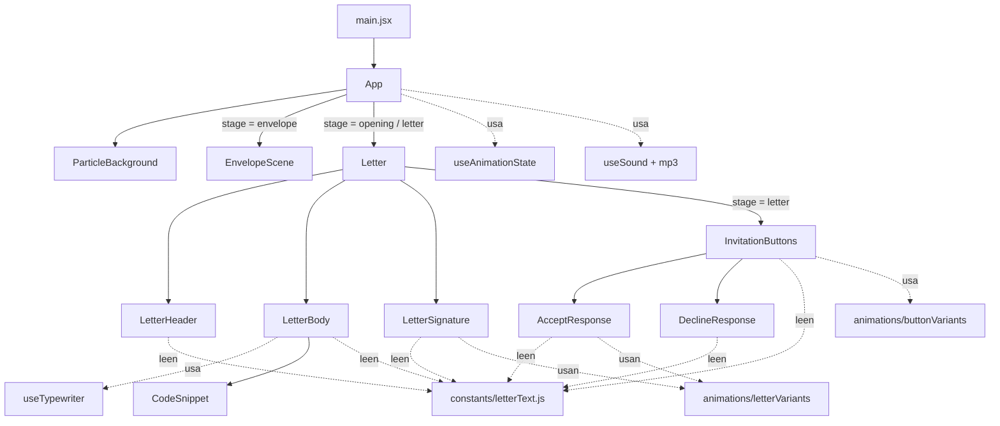
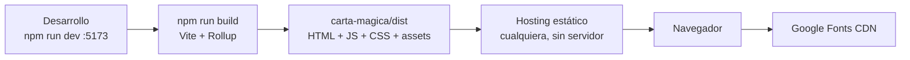
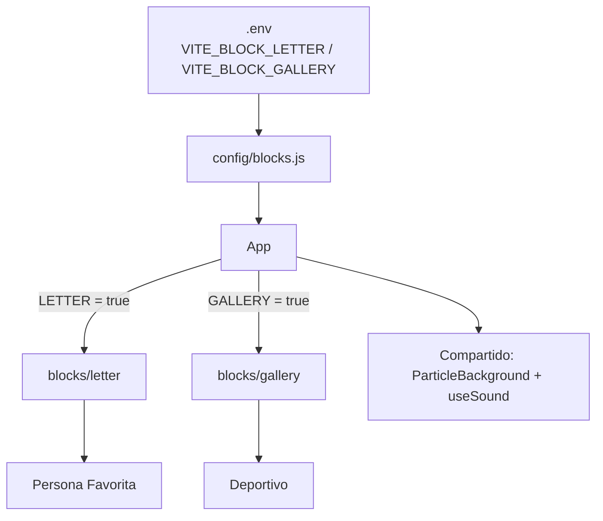

# Arquitectura e infraestructura

Estado documentado: el código actual (bloque único "carta"). Lo marcado como **Planificado** aún no existe; ver [PLAN_LIMPIEZA.md](../PLAN_LIMPIEZA.md).

## Stack

| Capa | Tecnología | Notas |
|---|---|---|
| Build y dev server | Vite 6 | `vite.config.js` fija `root: 'carta-magica'` |
| UI | React 19 | Sin router ni estado global; estado local con hooks |
| Estilos | Tailwind 4 (`@tailwindcss/vite`) + `index.css` | CSS propio para el sobre 3D y el pergamino |
| Animación | Framer Motion 12 | Variantes en `src/animations/` |
| Audio | `HTMLAudioElement` vía `useSound` | Sin librerías |
| Fuentes | Google Fonts (Great Vibes, Playfair Display, JetBrains Mono) | Cargadas desde `index.html` |
| Backend / base de datos | Ninguno | Sitio 100 % estático |

## Estructura de carpetas

```
Proyect_love/
├── vite.config.js          # root = carta-magica, plugins react + tailwind
├── package.json            # scripts: dev, build, preview
├── .npmrc                  # ignore-scripts=true (seguridad de instalación)
├── PLAN_LIMPIEZA.md        # tareas pendientes y decisiones
├── docs/                   # esta documentación
└── carta-magica/
    ├── index.html          # metadatos, fuentes, <div id="root">
    ├── dist/               # salida de `npm run build` (versionada hoy)
    └── src/
        ├── main.jsx        # monta <App /> en StrictMode
        ├── App.jsx         # selector de etapas + música
        ├── index.css       # Tailwind + estilos del sobre/pergamino
        ├── animations/     # variantes de Framer Motion
        ├── assets/
        │   ├── sounds/     # mp3 (Persona Favorita en uso; Deportivo reservada)
        │   └── textures/   # paper1.png (fondo pergamino)
        ├── components/
        │   ├── envelope/EnvelopeScene.jsx
        │   ├── letter/     # Letter, LetterHeader, LetterBody, LetterSignature
        │   ├── invitation/ # InvitationButtons, AcceptResponse, DeclineResponse
        │   └── ui/         # ParticleBackground, CodeSnippet
        ├── constants/letterText.js   # todos los textos de la carta
        └── hooks/          # useAnimationState, useSound, useTypewriter
```

## Diagrama de componentes



## Infraestructura de despliegue



Al ser estático, sirve cualquier hosting de archivos (Netlify, Vercel, GitHub Pages, Cloudflare Pages). Todavía no hay configuración de despliegue en el repo; **el proveedor está por decidir**.

## Seguridad de dependencias

- `.npmrc` con `ignore-scripts=true`: los scripts de instalación de terceros no se ejecutan.
- Instalar con `npm ci --ignore-scripts`. Si `esbuild` lo necesita, `npm rebuild esbuild` explícito.
- `npm audit`: 0 vulnerabilidades en producción; las de desarrollo están en el plan.

## Planificado: bloques con interruptor



Las variables `VITE_*` se resuelven en el build y quedan visibles en el bundle: son un interruptor, no un secreto.
