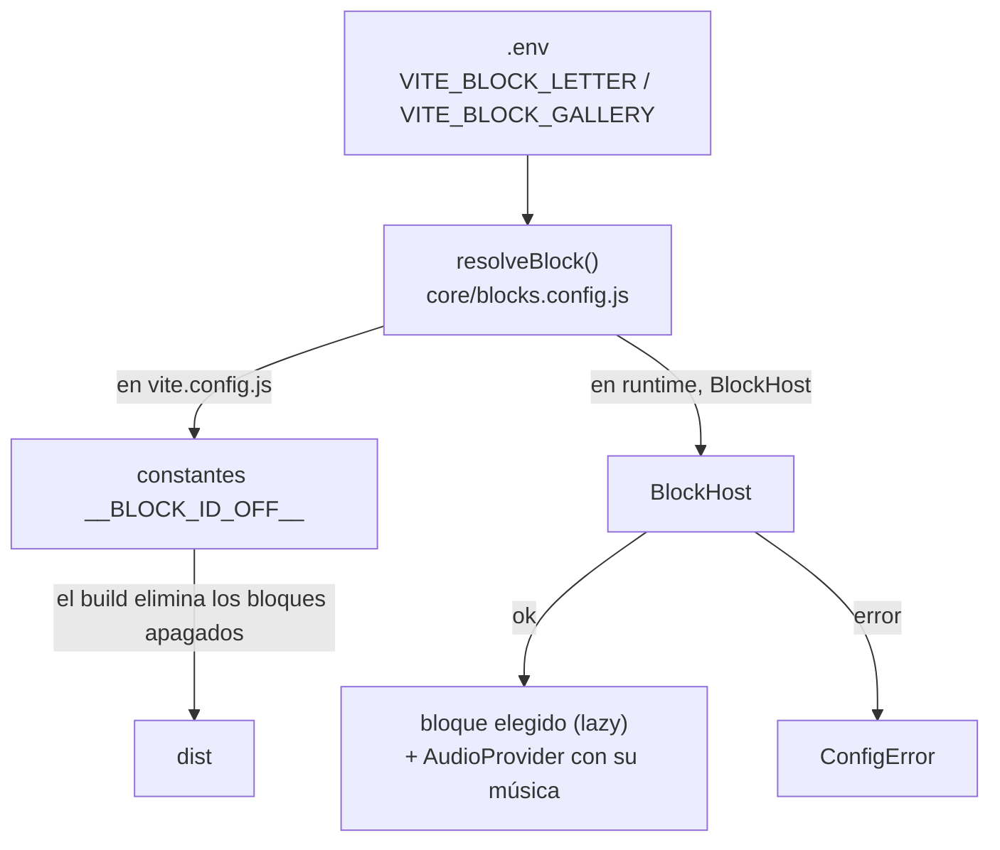
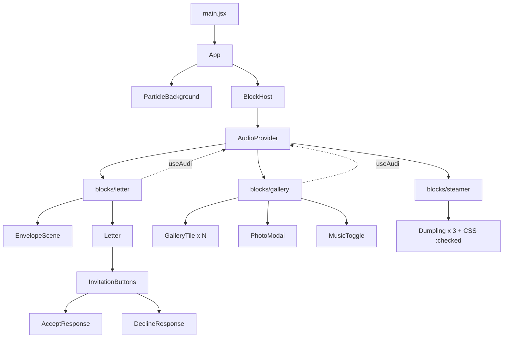
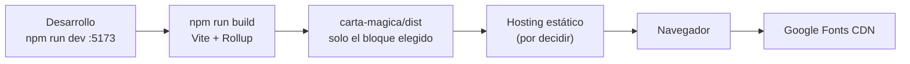

# Arquitectura e infraestructura

Documenta el estado actual del código: un shell que muestra **un bloque a la vez**, elegido por variables de entorno al compilar.

## Stack

| Capa | Tecnología | Notas |
|---|---|---|
| Build y dev server | Vite 6 | `vite.config.js` fija `root: 'carta-magica'` y define las constantes de bloques |
| UI | React 19 | Sin router ni estado global; estado local con hooks y un contexto de audio |
| Estilos | Tailwind 4 (`@tailwindcss/vite`) + CSS por bloque | `shared/styles/base.css` + `blocks/<id>/<id>.css` |
| Animación | Framer Motion 12 | |
| Audio | `HTMLAudioElement` vía `useSound` | Sin librerías |
| Pruebas | `node --test` (integrado en Node) | Sin dependencias extra |
| Fuentes | Google Fonts (Great Vibes, Playfair Display, JetBrains Mono) | Cargadas desde `index.html` |
| Backend / base de datos | Ninguno | Sitio 100 % estático |

## Estructura de carpetas

```
Proyect_love/
├── vite.config.js          # root = carta-magica; lista BLOCKS y constantes __BLOCK_<ID>_OFF__
├── package.json            # scripts: dev, build, preview, test
├── .npmrc                  # ignore-scripts=true (seguridad de instalación)
├── PLAN_LIMPIEZA.md        # plan de limpieza general
├── docs/                   # esta documentación
└── carta-magica/
    ├── index.html          # metadatos, fuentes, <div id="root">
    ├── .env.example        # interruptores de bloques (copiar a .env)
    ├── dist/               # salida de `npm run build` (versionada)
    └── src/
        ├── main.jsx        # monta <App /> en StrictMode
        ├── App.jsx         # shell: fondo compartido + <BlockHost />
        ├── core/           # selección de bloque y audio
        │   ├── blocks.config.js        # resolvedor puro (+ .test.js)
        │   ├── registry.js             # lista de bloques y cómo cargarlos
        │   ├── BlockHost.jsx           # monta el bloque activo (carga perezosa)
        │   ├── AudioProvider.jsx       # música del bloque: start / stop / toggle
        │   └── ConfigError.jsx         # pantalla de configuración inválida
        ├── shared/         # lo que usan todos los bloques
        │   ├── ParticleBackground.jsx
        │   ├── useSound.js, useGoogleFont.js
        │   └── styles/base.css
        └── blocks/
            ├── letter/     # bloque 1: sobre + carta + invitación
            │   ├── index.jsx, block.meta.js, content.js, letter.css
            │   ├── components/ hooks/ animations/
            │   └── assets/ (paper1.png, sounds/persona-favorita.mp3)
            ├── gallery/    # bloque 2: calendario de recuerdos
            │   ├── index.jsx, block.meta.js, content.js, gallery.css
            │   ├── components/ (GalleryTile, PhotoModal, MusicToggle, Placeholder)
            │   ├── hooks/useOpenedDoors.js
            │   └── assets/ (photos/, sounds/deportivo.mp3)
            └── steamer/    # bloque 3: cesto de vapor con bolitas (solo CSS, sin música)
                ├── index.jsx, block.meta.js (music: null), content.js, steamer.css
                └── components/Dumpling.jsx
```

## Cómo se elige el bloque



Reglas del resolvedor (`resolveBlock`):
- Un bloque está activo si su variable vale `true`; `false` lo apaga.
- Sin ninguna variable definida, se muestra el primer bloque del registro (la carta).
- Un valor distinto de `true`/`false` es un error (`INVALID_FLAG`); sin ningún bloque activo, también (`NO_ACTIVE_BLOCK`).
- Con varios activos gana el primero del registro y se emite un aviso en consola.

El mismo resolvedor corre dos veces: en `vite.config.js` (para dejar fuera del build lo que no se muestra) y en la app (para elegir qué montar). Los valores `VITE_*` se fijan al compilar y quedan visibles en el bundle: son un interruptor, no un secreto. Cambiarlos exige reiniciar `dev` o repetir `build`.

## Diagrama de componentes



## Contrato de un bloque

Un bloque es una carpeta `blocks/<id>/` con:
- `index.jsx`: `export default` del componente raíz (sin props).
- `block.meta.js`: `export default { id, title, music, musicVolume }`.
- Sus propios textos, estilos, componentes y assets. No lee variables de entorno ni conoce a otros bloques.

Pide la música al shell con `useAudio()` (`startMusic`, `stopMusic`, `toggleMusic`, `isPlaying`). `startMusic` debe llamarse desde un gesto del usuario.

Pasos para añadir uno: [NUEVO_BLOQUE.md](NUEVO_BLOQUE.md).

## Infraestructura de despliegue



Sitio estático: sirve cualquier hosting de archivos (Netlify, Vercel, GitHub Pages, Cloudflare Pages). **El proveedor sigue sin definir** y no hay configuración de despliegue en el repo.

## Seguridad de dependencias

- `.npmrc` con `ignore-scripts=true`: los scripts de instalación de terceros no se ejecutan.
- Instalar con `npm ci --ignore-scripts`. Si `esbuild` lo necesita, `npm rebuild esbuild` explícito.
- `npm audit`: 0 vulnerabilidades en producción; las de desarrollo (vite 6.4.2 y dependencias) siguen pendientes de actualizar.
- Las pruebas usan el ejecutor integrado de Node para no sumar dependencias.

## Pruebas

```bash
npm test   # node --test sobre carta-magica/src/**/*.test.js
```

Cubren el resolvedor de bloques (10 casos). La interfaz se revisa a mano con [VERIFICACION_CARTA.md](VERIFICACION_CARTA.md) y [VERIFICACION_GALERIA.md](VERIFICACION_GALERIA.md).
