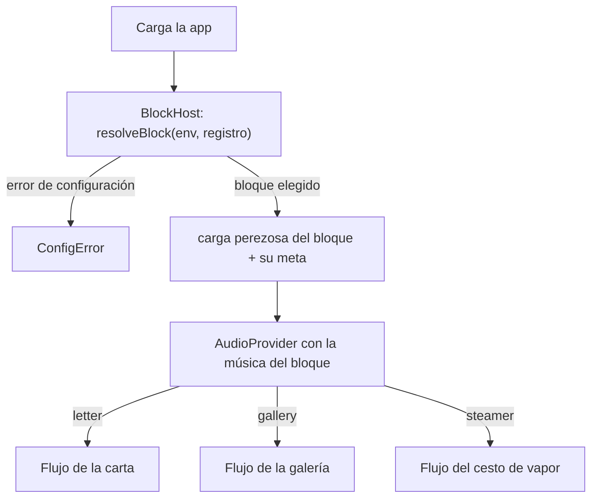
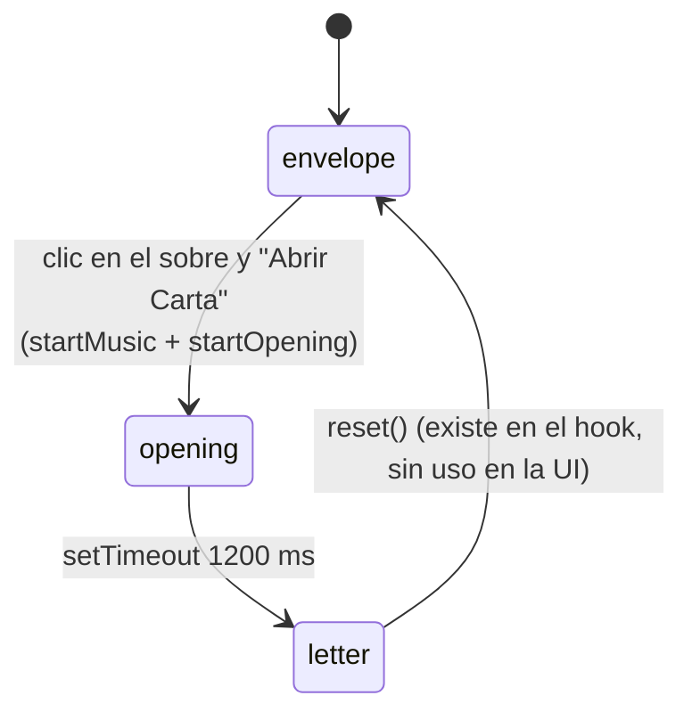
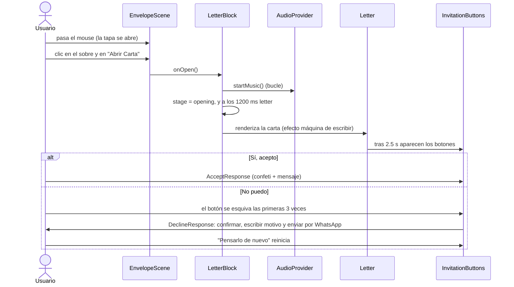
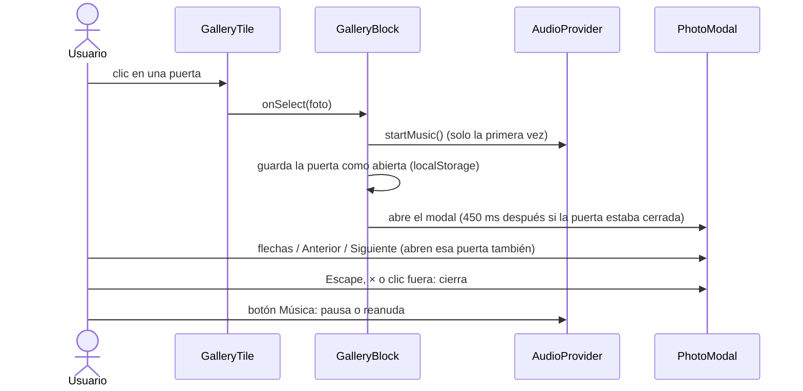
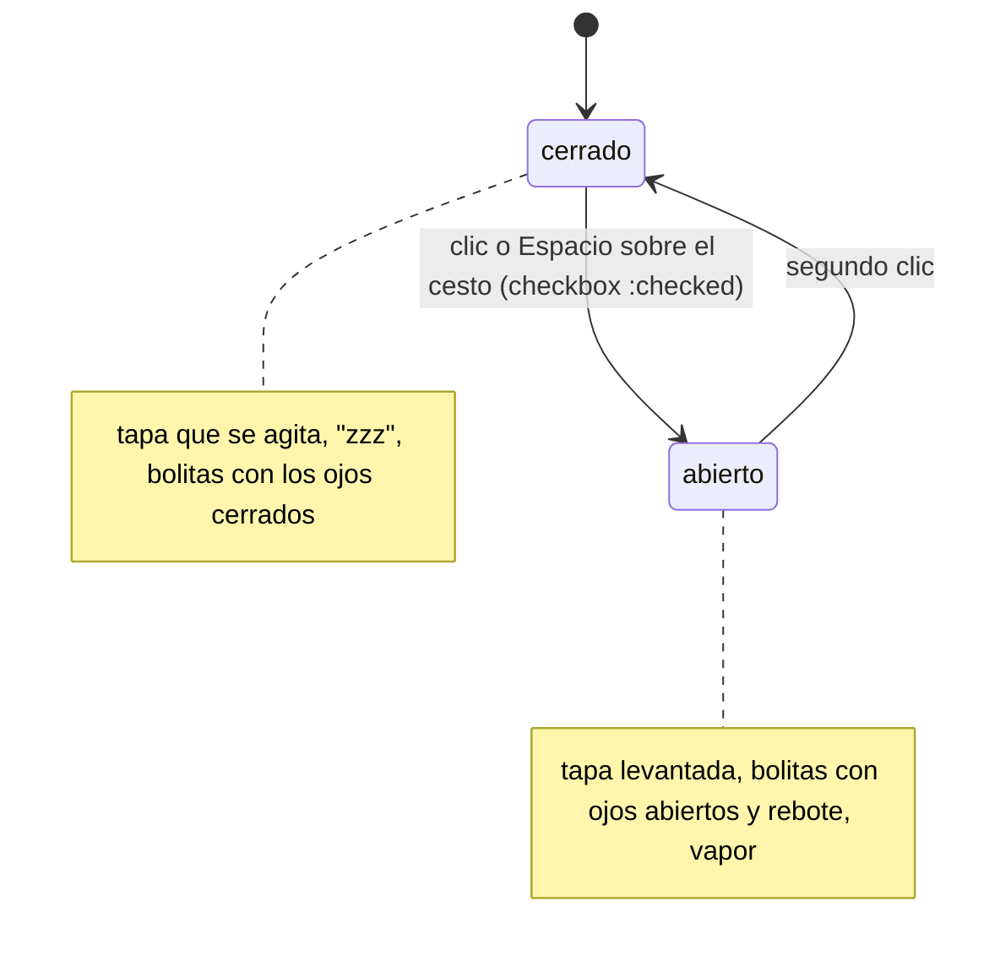
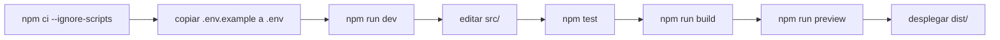

# Flujo de la experiencia

## Arranque

## Bloque carta

`useAnimationState` maneja tres etapas: `envelope` → `opening` → `letter`.

## Bloque galería

## Bloque cesto de vapor

Toda la interacción es CSS, sin estado de React: un `checkbox` oculto (`#lid-toggle`) y su `label` (el cesto). Al marcarlo, los selectores `:checked + .steamer` y `:checked ~ .caption` abren la tapa, levantan las bolitas, hacen salir el vapor y cambian la leyenda.

Sin música (`music: null` en `block.meta.js`). Respeta `prefers-reduced-motion`. La estructura `input` → `label.steamer` → `h1` → `p.caption` debe mantenerse en ese orden, porque el CSS usa selectores de hermanos.

## Dónde editar cada cosa

| Quiero cambiar... | Archivo |
|---|---|
| Qué bloque se muestra | `carta-magica/.env` (reiniciar `dev`) |
| Textos de la carta (nombre, párrafos, firma, respuestas) | `src/blocks/letter/content.js` |
| Música de la carta | `src/blocks/letter/block.meta.js` |
| Duración de la apertura | `src/blocks/letter/hooks/useAnimationState.js` |
| Velocidad de escritura | `src/blocks/letter/hooks/useTypewriter.js` (`speed`) |
| Cuántas veces huye el botón "No" | `src/blocks/letter/components/invitation/InvitationButtons.jsx` |
| Número de WhatsApp y mensaje del rechazo | `src/blocks/letter/components/invitation/DeclineResponse.jsx` |
| Fotos de la galería | copiarlas a `src/blocks/gallery/assets/photos/` |
| Título, textos y tamaño de cada foto | `src/blocks/gallery/content.js` (`PHOTO_DETAILS`) |
| Tamaño de celdas y puertas | `src/blocks/gallery/gallery.css` |
| Música de la galería | `src/blocks/gallery/block.meta.js` |
| Textos del cesto de vapor (título, leyendas) | `src/blocks/steamer/content.js` |
| Colores, tamaño y animaciones del cesto | `src/blocks/steamer/steamer.css` (variables al inicio, bajo `.steamer-block`) |
| Colores globales y fondo | `src/shared/styles/base.css` |
| Título, descripción al compartir, fuentes | `carta-magica/index.html` |

## Flujo de trabajo del desarrollador

