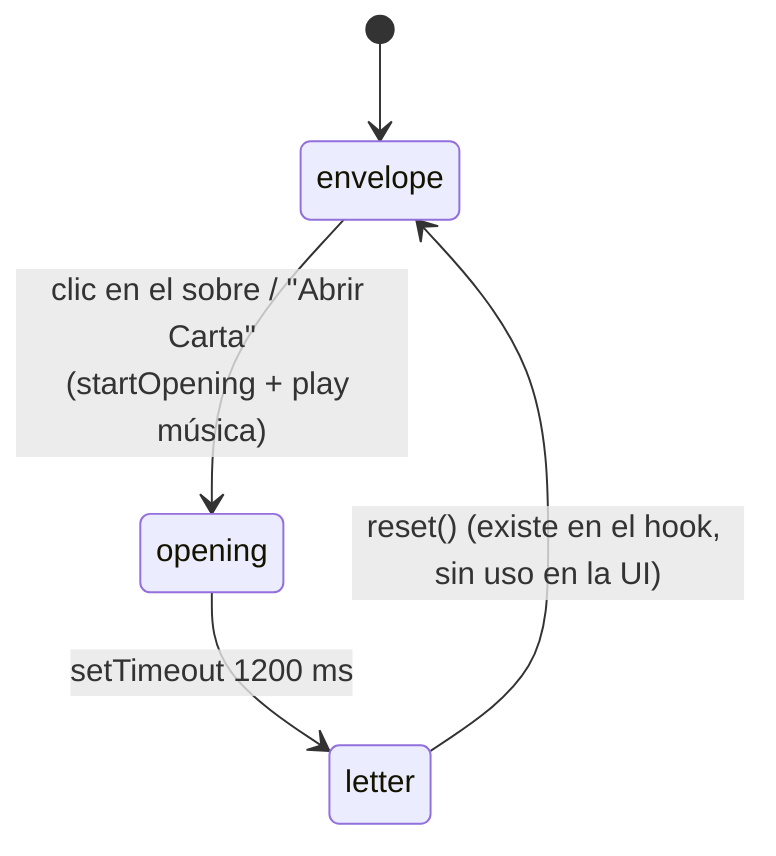
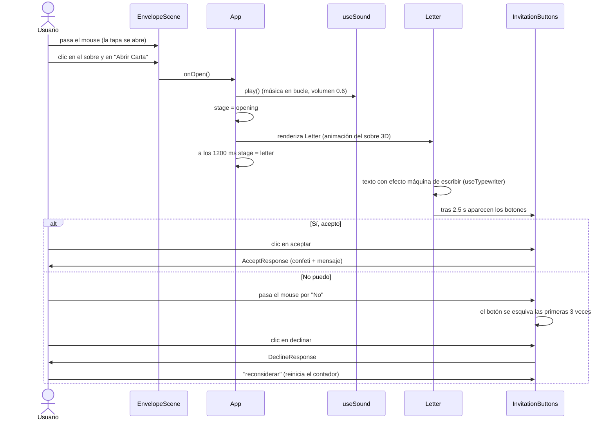
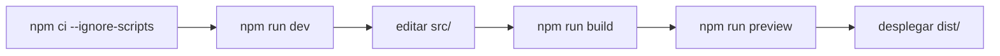

# Flujo de la experiencia

## Etapas

`useAnimationState` maneja tres etapas: `envelope` → `opening` → `letter`. `App.jsx` renderiza según la etapa.

## Secuencia de usuario

## Dónde editar cada cosa

| Quiero cambiar... | Archivo |
|---|---|
| Nombre, párrafos, firma, mensajes y etiquetas | `src/constants/letterText.js` |
| Música de fondo | `src/App.jsx` (import del mp3, volumen) |
| Duración de la apertura | `src/hooks/useAnimationState.js` |
| Velocidad de escritura | `src/hooks/useTypewriter.js` (parámetro `speed`) |
| Cuántas veces huye el botón "No" | `src/components/invitation/InvitationButtons.jsx` (`dodgeCount < 3`) |
| Colores, sobre y pergamino | `src/index.css` |
| Título, descripción al compartir, fuentes | `carta-magica/index.html` |

## Flujo de trabajo del desarrollador

## Flujo planificado con bloques

1. Editar `.env` (`VITE_BLOCK_LETTER`, `VITE_BLOCK_GALLERY`).
2. Reiniciar `npm run dev` o rehacer `npm run build`.
3. `App.jsx` monta solo el bloque activo; cada bloque trae su música y textos.
